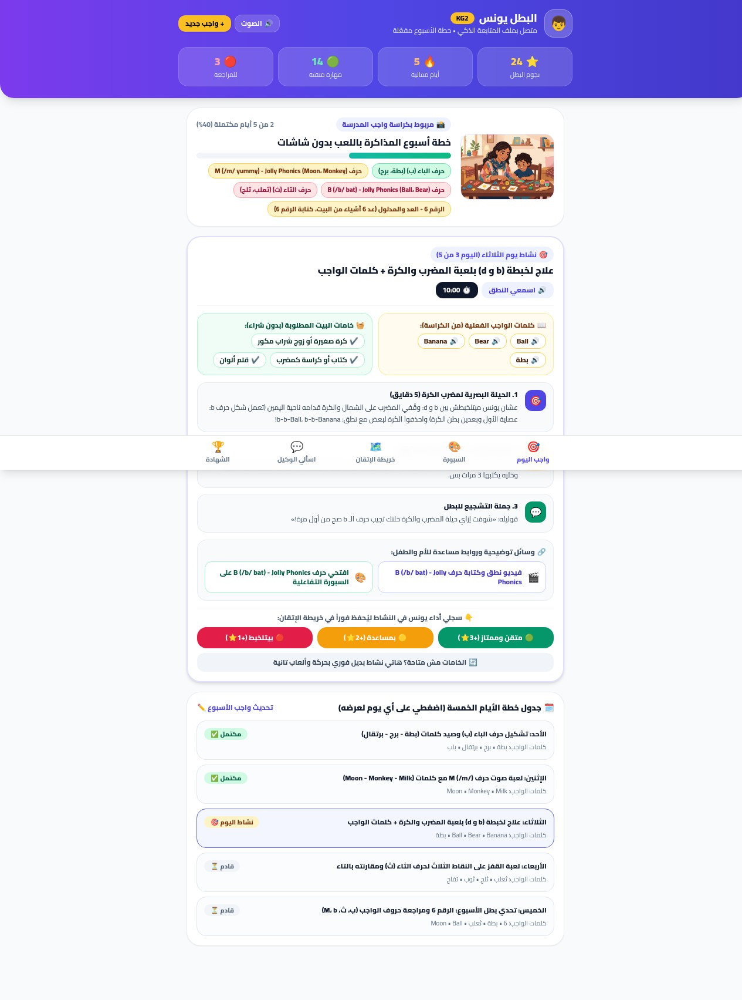

<div dir="rtl" align="center">

# 📚 رفيق المذاكرة | KidsActi

**بوت تليجرام + تطبيق مصغر يحوّل واجب طفلك إلى خطة لعب 5 أيام… بدون شاشات، وبذكاء اصطناعي.**

[](https://t.me/kidsactibot)
[](https://omar-x-art.github.io/kidsacti/)
[]()
[]()
[](LICENSE)

</div>

## الفكرة

ماما بتصوّر صفحة الواجب (أو تكتبه أو تسجّله صوتيًا)، والوكيل الذكي يقرأ الكلمات الفعلية من الواجب ويبني خطة أسبوع من 5 أيام لعب تعليمي على نفس الكلمات بالضبط: أنشطة، خامات بيتية، مؤقت مذاكرة، نطق صوتي، خريطة إتقان لـ 68 مهارة، وشهادة بطل أسبوعية. كل ده داخل تليجرام من غير أي تطبيق إضافي.

## المميزات

- **وكيل ذكي يقرأ الواجب فعليًا**: يقرأ الكلمات من صورة الواجب أو الرسالة/الصوت ويصمم الأنشطة الخمسة على نفس الكلمات والحروف (بدل أنشطة عامة عشوائية).
- **تتبع إتقان حقيقي**: كل نشاط مربوط برمز مهارة قياسي (`focus_skill_id`) فيتحدث عداد المحاولات وملاحظات الأم وخريطة الإتقان فورًا.
- **بطاقة بصرية لكل نشاط**: صورة توضيحية + أزرار مباشرة لفيديو النطق والسبورة التفاعلية.
- **محادثة طبيعية بالعامية المصرية**: يفهم الأسئلة التربوية والرسائل الصوتية وتغيير الخامات وتحديث مستوى الطفل من سياق الكلام.
- **تطبيق مصغر بـ 5 تبويبات**: واجب اليوم (مؤقت + نطق)، السبورة التفاعلية، خريطة 68 مهارة، شات المساعد التربوي، وشهادة بطل الأسبوع.
- **رسالة انتظار احترافية**: على أي تفاعل تظهر فورًا رسالة بنصيحة تربوية متغيرة تتحول للإجابة النهائية.
- **بدائل ذكية عند الفشل**: Gemini ثم NVIDIA vision تلقائيًا، ورسالة خطأ واضحة بدل الصمت.

## لقطات

<div align="center">

</div>

## البنية التقنية

```
supabase/
  functions/
    telegram-webhook/   # الوكيل الذكي: استقبال التحديثات، Gemini، التخطيط، الردود
    miniapp-api/        # واجهة التطبيق المصغر (initData + JWT)
    daily-dispatch/     # إرسال نشاط كل يوم + تذكيرات (cron كل ساعة)
miniapp/index.html      # التطبيق المصغر (5 تبويبات) — GitHub Pages
supabase/migrations/    # 0001 init + 0002 smart agent
```

قاعدة البيانات: `children` · `weekly_plans_and_activities` · `curriculum_skills` (68 مهارة) · `child_mastery_tracker` · `conversation_history`.

موديلات AI: `gemini-flash-latest` (صور/نص) · `gemini-flash-lite-latest` (نصوص) · `gemini-3.8-flash-tts` (نطق) · NVIDIA `llama-3.2-90b-vision` كاحتياط.

## التشغيل

1. Supabase: نفّذ الميجريشنين من `supabase/migrations/`.
2. اضبط الأسرار: `TELEGRAM_BOT_TOKEN`, `TELEGRAM_WEBHOOK_SECRET`, `GEMINI_API_KEY`, `NVIDIA_API_KEY`, `MINIAPP_URL`, `CRON_SECRET`.
3. انشر الدوال: `supabase functions deploy telegram-webhook miniapp-api daily-dispatch`.
4. اربط الويبهوك على `telegram-webhook` واضبط زرار القائمة على رابط التطبيق المصغر.

## Roadmap

- [x] الوكيل الذكي وخطة 5 أيام مربوطة بكلمات الواجب
- [x] خريطة الإتقان والبطاقات البصرية والمحادثة الذكية
- [x] التطبيق المصغر بـ 5 تبويبات
- [ ] لوحة ولي أمر أسبوعية بالبريد
- [ ] دعم مراحل أعم من KG2

## الترخيص

MIT — انظر [LICENSE](LICENSE).

<div align="center">
صنع بـ ❤️ في القاهرة — <a href="https://github.com/Omarhussien2">Omar Hussien</a>
</div>
